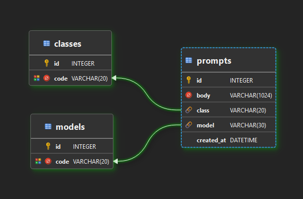
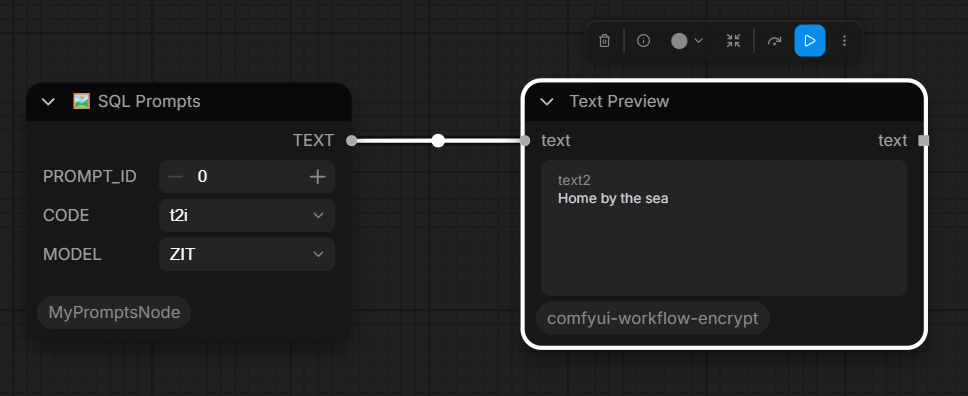

# ComfyPrompts - cudstom node (Prompts helper) for ComfyUI

## Initial request

Napisz CumfyUI Custom Node 'MY-PROMPTS' w postaci skryptu python.
Skrypt python odczytuje losowy lub kolejny prompt bezpośrednio z bazy SQLite przy każdym uruchomieniu.

Node Inputs:
* PROMPT_ID, NUMBER, Numer id rekordu z bazy danych
* CODE,  Pole wyboru wartości 'code' z tabeli 'classes'
* MODEL, Pole wyboru wartości 'code' z tabeli 'models'

Node Output:
* TEXT, prompt pobrany z bazy danych (pole body tabeli prompts)

Baza danych SQLite3
* Nazwa: 'prompts.db'
* Schemat:
```sql
PRAGMA foreign_keys = ON;

CREATE TABLE IF NOT EXISTS classes (
    id   INTEGER PRIMARY KEY,
    code VARCHAR(20) NOT NULL UNIQUE
);

CREATE TABLE IF NOT EXISTS models (
    id   INTEGER PRIMARY KEY,
    code VARCHAR(20) NOT NULL UNIQUE
);

CREATE TABLE IF NOT EXISTS prompts (
    id         INTEGER PRIMARY KEY,
    body       VARCHAR(1024) NOT NULL,
    class      VARCHAR(20),
    model      VARCHAR(30),
    created_at DATETIME,
    FOREIGN KEY (class) REFERENCES classes(code),
    FOREIGN KEY (model) REFERENCES models(code)
);
```

## Initial documentation

### Database schema



### ComfyUI sample workflow




## References:
* [Sqlite 3 documentation](https://sqlite.org/cli.html)
* [Sqlite 3 python](https://www.geeksforgeeks.org/python/python-sqlite-create-table/)
